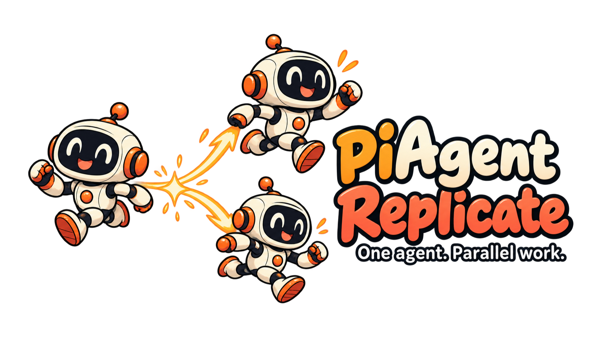

<p align="center">
  
</p>

<h1 align="center">Pi Agent Replicate</h1>

<p align="center">One agent. Parallel work.</p>

<div align="center">

[](https://www.npmjs.com/package/pi-agent-replicate)
[](https://www.npmjs.com/package/pi-agent-replicate)
[](./LICENSE)

</div>

Give your [Pi](https://github.com/earendil-works/pi) agent the ability to work in parallel in [Herdr](https://herdr.dev). It creates copies of itself for independent parts of a task, keeps working, and receives their results automatically.

Each copy starts with the current conversation, system prompt, model, thinking level and active tools. It has the context it needs to continue the work, rather than starting from scratch.

## Install

```bash
pi install npm:pi-agent-replicate
```

Start Pi inside Herdr, then restart Pi or run `/reload`.

## How it works

The extension adds one tool, `replicate`. The agent calls it with a task-specific name and a bounded assignment:

```typescript
replicate({
  name: "check-auth-risks",
  task: "Check authentication risks while I implement the settings change. Return concrete findings with file references.",
});
```

The name uses lowercase kebab-case. The copy works in its own Pi session and can create copies of its own. When its work and any child work finish, the result returns to the original agent automatically. The original can continue independent work or end its turn while it waits; it does not need to poll.

Use replication when there are genuinely independent tasks to do in parallel, not simply to hand off a task and wait. Copies inherit the conversation and tools, but their subsequent conversations are separate.

## Where copies work

By default, each copy works in a separate Git worktree. It starts with a snapshot of the parent's tracked changes and non-ignored new files. Ignored files, dependencies and build outputs are not copied. On success, the host attempts to apply the copy's changes to the parent without changing its HEAD or staging. A conflict or failure leaves the copy's work available for review rather than applying partial changes. A clean join does not guarantee the combined code is correct.

Worktree mode requires a non-bare Git checkout with a commit. Snapshots do not support unresolved index conflicts, sparse or assume-unchanged index entries, submodules or nested Git repositories. Worktrees isolate files, not shared processes, ports or databases.

For projects that need the same directory, such as Unity projects, switch to shared mode:

```text
/replica-directory shared
```

Shared copies work in the parent's current directory, including ignored files and dependencies. They do not create a worktree or branch, and there is no snapshot or automatic join. Changes are visible immediately and can remain even if a copy fails. Coordinate assignments: parallel edits to the same files can overwrite each other, and there is no automatic rollback.

Use `/replica-directory worktree` to switch back, or `/replica-directory` to choose interactively. The setting is saved in `.pi/replicate.json` in the current project directory and applies to new copies only.

## When a copy stops

A completed copy returns its summary automatically. If it fails, is interrupted or loses its process, the parent receives a failure and any available answer information. Copies do not restart automatically; the parent can create a fresh copy if needed. In worktree mode, failed or conflicted work remains available for recovery; in shared mode, changes may already be in the shared directory.

## More information

See the [documentation](docs/README.md) for technical contracts and [development instructions](docs/development.md).

## License

[MIT](LICENSE)
